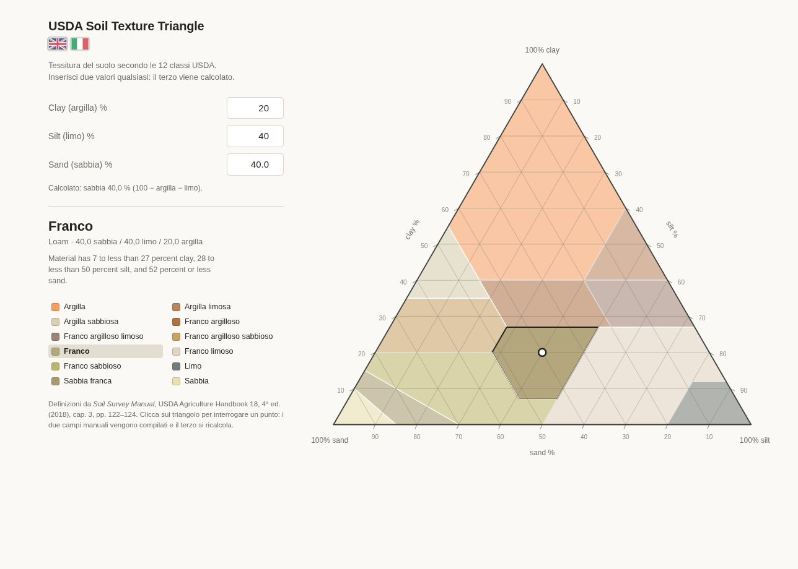

# USDA Soil Texture Triangle

[English](README.md) | **Italiano**

Strumento per determinare la classe tessiturale di un suolo a partire dalle
percentuali di sabbia, limo e argilla, secondo le 12 classi del sistema USDA.

**Demo online:** <https://lucaarcteam.github.io/soil-texture-triangle/>

<p align="center">
  
</p>

- App: `arc-team_tools_usda_soil_triangle_v15.html`
- Dati: `data/classes.js` (generato, non modificare a mano)
- Regole: `data/rules.json` (fonte di verità, modificabile)
- Build: `tools/build_dataset.py`
- Lingue: italiano e inglese, con due bandierine sotto il titolo
- Licenza: GPL-3.0-or-later (vedi [`LICENSE`](LICENSE))

L'app funziona offline: dipende solo da `js/raphael.js` (Raphaël 2.0, già
presente nel repo) e da `data/classes.js`. Nessuna CDN, nessuna chiamata di rete.

---

## 1. La fonte

Le classi e i confini vengono dal **Soil Survey Manual**, USDA Agriculture
Handbook No. 18, 4ª edizione (2018), capitolo 3, sezione *Definitions of Soil
Texture Classes and Subclasses*, pp. 122–124.

<https://www.nrcs.usda.gov/sites/default/files/2022-09/The-Soil-Survey-Manual.pdf>

È la stessa fonte citata dalla voce Wikipedia *Soil texture*, che però riporta
solo i nomi delle classi e un esempio, non i confini.

Riferimento introduttivo: <https://en.wikipedia.org/wiki/Soil_texture>

### Le 12 classi USDA

| Classe | Italiano | Area |
|---|---|---|
| Sand | Sabbia | 1,50 % |
| Loamy Sand | Sabbia franca | 3,00 % |
| Sandy Loam | Franco sabbioso | 11,47 % |
| Loam | Franco | 7,11 % |
| Silt Loam | Franco limoso | 16,35 % |
| Silt | Limo | 3,36 % |
| Sandy Clay Loam | Franco argilloso sabbioso | 7,76 % |
| Clay Loam | Franco argilloso | 6,50 % |
| Silty Clay Loam | Franco argilloso limoso | 5,20 % |
| Sandy Clay | Argilla sabbiosa | 4,00 % |
| Silty Clay | Argilla limosa | 4,00 % |
| Clay | Argilla | 29,75 % |

Le aree sono calcolate sul triangolo e sommano a 100,0000 %.

---

## 2. Come funziona il calcolo

Il triangolo è un *ternary plot*. I tre vertici nello spazio di coordinate
SVG 800×800:

| Vertice | x | y |
|---|---|---|
| 100 % clay (apice) | 385.21708 | 75.27597 |
| 100 % silt (in basso a destra) | 722.222 | 658.4768 |
| 100 % sand (in basso a sinistra) | 48.212218 | 658.4768 |

La posizione del punto è l'interpolazione baricentrica delle tre percentuali:

```
x = (clay·385.21708 + silt·722.222 + sand·48.212218) / 100
y = (clay·75.27597  + silt·658.4768 + sand·658.4768)  / 100
```

Il passaggio inverso (dal click sul triangolo alla composizione) risolve lo
stesso sistema lineare. Verificato: errore massimo di andata e ritorno
≈ 4·10⁻¹⁴ punti percentuali.

### Perché le regole e non i poligoni

La classificazione usa direttamente le diseguaglianze del Soil Survey Manual
(es. *"40 percent or more clay, 45 percent or less sand, and less than 40
percent silt"*). I poligoni servono solo a disegnare ed evidenziare le classi:
sono generati dalle stesse regole con shapely, quindi coincidono per
costruzione con la classificazione e non c'è bisogno di disegnarli a mano.

---

## 3. Pipeline dei dati

```
data/rules.json            regole USDA scritte a mano, con citazione della fonte
        │
        ├── tools/build_dataset.py     genera e valida
        │
        ├── data/classes.json          dataset leggibile (per altri usi)
        └── data/classes.js            dataset per il browser (window.SOIL_TRIANGLE_DATA)
```

Ogni disequazione `a·sand + b·silt + c·clay OP d` diventa un semipiano in
(sand, silt), perché `clay = 100 − sand − silt`. Il poligono di una classe è
l'intersezione del triangolo con quei semipiani: confini esatti, nessun
approssimazione numerica. Le classi con più clausole (Silt Loam, Sandy Loam)
vengono unite con shapely per evitare bordi interni spuri.

### Ricostruire il dataset

```bash
python3 tools/build_dataset.py          # valida e riscrive data/
python3 tools/build_dataset.py --check  # solo validazione, non scrive
```

Dipendenze del build: `shapely`. L'app non ne ha bisogno.

### Esito della validazione

```
somma aree           100.0000 %
sovrapposizioni        0.000000 px²
area non coperta       0.000036 px²
regole vs poligoni     0 disaccordi su 17.865 punti interni
casi di prova         18/18
```

---

## 4. Interfaccia

L'app parte con **0 / 0 / 0** e nessuna classe selezionata: il triangolo è
visibile, ma il punto e l'esito compaiono solo quando ci sono dati.

- **Si possono inserire due componenti qualsiasi**: clay+silt, clay+sand,
  silt+sand. Il terzo è sempre calcolato come `100 − gli altri due`.
- La regola è implicita, senza selettore: **gli ultimi due campi che modifichi
  restano manuali**, il meno recente diventa quello calcolato. All'avvio il
  calcolato è *sand*.
- Tutti e tre i campi hanno lo stesso aspetto: nessun campo è marcato come
  calcolato e la casella resta bianca.
- La riga di stato dice sempre qual è il calcolo in corso, per esempio
  *"Calcolato: sabbia 39,9 % (100 − argilla − limo)"*.
- **Lingua**: due bandierine sotto il titolo, inglese e italiana. Cambiano al
  volo etichette, messaggi, nomi delle classi, note e separatore decimale
  (virgola in italiano, punto in inglese). La scelta è salvata in
  `localStorage` (`soilTriangleLang`); al primo avvio si parte dalla lingua del
  browser. Il titolo `USDA Soil Texture Triangle` resta uguale nelle due
  versioni, come i nomi tecnici degli assi.
- Se i due valori manuali superano 100 la riga diventa rossa, il punto sparisce
  e non viene classificato nulla. I valori fuori da 0–100 vengono riportati
  nell'intervallo.
- Il punto si sposta sul triangolo e la classe viene evidenziata; tornando a
  0 / 0 / 0 il punto sparisce e nessuna classe resta selezionata.
- **Click sul triangolo**: converte la posizione in composizione, compila i due
  campi manuali e ricalcola il terzo (interrogazione diretta).
- **Legenda**: click su una classe mostra la sua definizione ufficiale
  (interrogazione inversa: dalla classe ai suoi limiti).
- **Reticolo interno ogni 10 %**: tre famiglie di linee (clay costante,
  orizzontali; sand costante, parallele al lato destro; silt costante,
  parallele al lato sinistro). Ogni linea va da una tacca all'altra, per esempio
  quella a silt 10 % unisce il punto 90 % sand sulla base al 10 % sull'asse del
  silt. Serve a leggere la composizione a occhio.
- Titoli degli assi al centro di ciascun lato, ruotati lungo il lato e staccati
  dalle tacche: `clay %` sul lato sinistro, `silt %` sul destro, `sand %` sulla
  base.
- Tacche ogni 10 % sui tre lati, con il valore numerico accanto a ciascuna.

La logica dei ruoli sta nella sezione `input` dello script:

```js
var manual  = ["clay", "silt"];   // manuali, dal più recente al meno recente
var derived = "sand";             // calcolato
```

`setEdited(key)` aggiorna i due ruoli a ogni modifica; `update()` ricalcola il
campo derivato e ridisegna. Per cambiare il campo calcolato all'avvio basta
cambiare `derived` (e `manual` di conseguenza).

API minima per test e integrazioni:

```js
window.SOIL_TRIANGLE_API.classify(sand, silt, clay)  // -> "loam"
window.SOIL_TRIANGLE_API.toXY(sand, silt, clay)      // -> {x, y}
window.SOIL_TRIANGLE_API.toComposition(x, y)         // -> {sand, silt, clay}
```

---

## 5. Limiti noti

- **Solo sistema USDA.** WRB e UK-ADAS usano classi e confini diversi
  (WRB: limo 0,002–0,063 mm invece di 0,002–0,05; UK-ADAS: 11 classi).
  L'architettura è pronta per un selettore: basta un altro `rules.<sistema>.json`.
- **Nessuna sottoclasse della sabbia.** *Coarse sand*, *fine sand*, *very fine
  sand* e le analoghe per loamy sand / sandy loam richiedono la distribuzione
  granulometrica per classi dimensionali, non solo i tre totali.
- **I punti esattamente sul confine** sono ambigui per definizione. Le regole
  vengono valutate nell'ordine dell'array `classes`; se nessuna corrisponde si
  riprova con tolleranza 10⁻⁶.
- Il metodo *texture by feel* non è implementato: è qualitativo.

---

## 6. File del progetto

| File | Ruolo |
|---|---|
| `arc-team_tools_usda_soil_triangle_v15.html` | l'app |
| `index.html` | redirect per GitHub Pages |
| `data/rules.json` | regole USDA, fonte di verità |
| `data/classes.js` | dataset generato per il browser |
| `data/classes.json` | dataset generato, formato aperto |
| `tools/build_dataset.py` | generatore + validatore |
| `js/raphael.js` | Raphaël 2.0 locale |
| `docs/screenshot.png` | screenshot in inglese usato in README.md |
| `docs/screenshot.it.png` | screenshot in italiano usato in README.it.md |
| `README.md` | documentazione in inglese |
| `README.it.md` | documentazione in italiano (questo file) |
| `LICENSE` | GNU General Public License v3.0 |

La cartella contiene solo i file necessari: le vecchie versioni `v02`–`v14`,
la `__pycache__` del build e la cartella `img/` (disegni a mano, legende PNG e
file di lavoro) sono state rimosse. I poligoni ora vengono generati dalle
regole, quindi i disegni originali non servono più.

Per rigenerare il dataset servono `data/rules.json` e `tools/build_dataset.py`;
l'app usa solo `data/classes.js` e `js/raphael.js`.

---

## 7. Licenza

Copyright (C) 2026 Luca Bezzi.

Questo programma è software libero: puoi ridistribuirlo e/o modificarlo secondo
i termini della GNU General Public License, versione 3 o successiva
(GPL-3.0-or-later). Il testo completo è in [`LICENSE`](LICENSE).

È distribuito nella speranza che sia utile, ma **senza alcuna garanzia**, senza
nemmeno la garanzia implicita di commerciabilità o idoneità a uno scopo
particolare. Vedi la GNU General Public License per i dettagli.

Le definizioni delle classi citate nell'app provengono dal *Soil Survey Manual*
(USDA Agriculture Handbook 18) e restano attribuite alla fonte originale.
