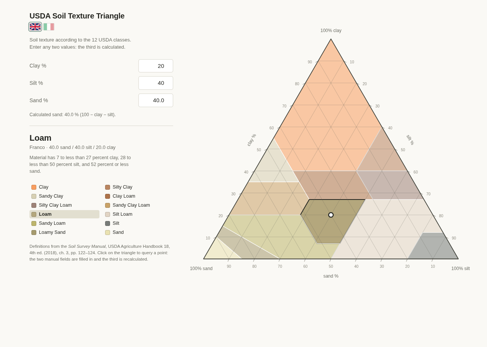

# USDA Soil Texture Triangle

[**English**](README.md) | [Italiano](README.it.md)

Tool to determine the soil texture class from the percentages of sand, silt and
clay, using the 12 classes of the USDA system.

**Live demo:** <https://lucaarcteam.github.io/soil-texture-triangle/>

<p align="center">
  
</p>

- App: `arc-team_tools_usda_soil_triangle_v15.html`
- Data: `data/classes.js` (generated, do not edit by hand)
- Rules: `data/rules.json` (source of truth, editable)
- Build: `tools/build_dataset.py`
- Languages: Italian and English, switchable with two flags below the title
- License: GPL-3.0-or-later (see [`LICENSE`](LICENSE))

The app works offline: it only depends on `js/raphael.js` (Raphaël 2.0, bundled
in the repository) and `data/classes.js`. No CDN, no network calls.

---

## 1. The source

The classes and boundaries come from the **Soil Survey Manual**, USDA
Agriculture Handbook No. 18, 4th edition (2018), chapter 3, section
*Definitions of Soil Texture Classes and Subclasses*, pp. 122–124.

<https://www.nrcs.usda.gov/sites/default/files/2022-09/The-Soil-Survey-Manual.pdf>

It is the same source cited by the Wikipedia article *Soil texture*, which
however only lists the class names and an example, not the boundaries.

Introductory reference: <https://en.wikipedia.org/wiki/Soil_texture>

### The 12 USDA classes

| Class | Italian | Area |
|---|---|---|
| Sand | Sabbia | 1.50 % |
| Loamy Sand | Sabbia franca | 3.00 % |
| Sandy Loam | Franco sabbioso | 11.47 % |
| Loam | Franco | 7.11 % |
| Silt Loam | Franco limoso | 16.35 % |
| Silt | Limo | 3.36 % |
| Sandy Clay Loam | Franco argilloso sabbioso | 7.76 % |
| Clay Loam | Franco argilloso | 6.50 % |
| Silty Clay Loam | Franco argilloso limoso | 5.20 % |
| Sandy Clay | Argilla sabbiosa | 4.00 % |
| Silty Clay | Argilla limosa | 4.00 % |
| Clay | Argilla | 29.75 % |

The areas are computed on the triangle and add up to 100.0000 %.

---

## 2. How the calculation works

The triangle is a *ternary plot*. The three vertices in the SVG 800×800
coordinate space:

| Vertex | x | y |
|---|---|---|
| 100 % clay (apex) | 385.21708 | 75.27597 |
| 100 % silt (bottom right) | 722.222 | 658.4768 |
| 100 % sand (bottom left) | 48.212218 | 658.4768 |

The position of the point is the barycentric interpolation of the three
percentages:

```
x = (clay·385.21708 + silt·722.222 + sand·48.212218) / 100
y = (clay·75.27597  + silt·658.4768 + sand·658.4768)  / 100
```

The inverse mapping (from a click on the triangle to the composition) solves the
same linear system. Verified: maximum round-trip error ≈ 4·10⁻¹⁴ percentage
points.

### Why rules instead of polygons

Classification uses the inequalities of the Soil Survey Manual directly
(e.g. *"40 percent or more clay, 45 percent or less sand, and less than 40
percent silt"*). Polygons are only used to draw and highlight the classes: they
are generated from the same rules with shapely, so they match the
classification by construction and do not need to be drawn by hand.

---

## 3. Data pipeline

```
data/rules.json            USDA rules written by hand, with source citation
        │
        ├── tools/build_dataset.py     generates and validates
        │
        ├── data/classes.json          readable dataset (for other uses)
        └── data/classes.js            browser dataset (window.SOIL_TRIANGLE_DATA)
```

Every inequality `a·sand + b·silt + c·clay OP d` becomes a half-plane in
(sand, silt), because `clay = 100 − sand − silt`. A class polygon is the
intersection of the triangle with those half-planes: exact boundaries, no
numerical approximation. Classes with multiple clauses (Silt Loam, Sandy Loam)
are merged with shapely to avoid spurious internal edges.

### Rebuilding the dataset

```bash
python3 tools/build_dataset.py          # validate and rewrite data/
python3 tools/build_dataset.py --check  # validation only, no writes
```

Build dependencies: `shapely`. The app does not need it.

### Validation result

```
area sum             100.0000 %
overlaps               0.000000 px²
uncovered area         0.000036 px²
rules vs polygons      0 disagreements on 17,865 interior points
test cases            18/18
```

---

## 4. Interface

The app starts at **0 / 0 / 0** with no class selected: the triangle is
visible, but the point and the result only appear once there is data.

- **Any two components can be entered**: clay+silt, clay+sand, silt+sand. The
  third is always calculated as `100 − the other two`.
- The rule is implicit, with no selector: **the last two fields you edit stay
  manual**, and the less recent one becomes the calculated field. At startup
  the calculated field is *sand*.
- All three fields look the same: no field is marked as calculated and the box
  stays white.
- The status line always says which calculation is in progress, for example
  *"Calculated sand: 39.9 % (100 − clay − silt)"*.
- **Language**: two flags below the title, English and Italian. They switch
  labels, messages, class names, notes and the decimal separator on the fly
  (comma in Italian, point in English). The choice is saved in `localStorage`
  (`soilTriangleLang`); on first load the browser language is used. The title
  `USDA Soil Texture Triangle` stays the same in both versions, as do the
  technical axis names.
- If the two manual values exceed 100, the line turns red, the point
  disappears and nothing is classified. Values outside 0–100 are clamped.
- The point moves on the triangle and the class is highlighted; going back to
  0 / 0 / 0 hides the point and clears the selection.
- **Click on the triangle**: converts the position into a composition, fills
  the two manual fields and recalculates the third (direct query).
- **Legend**: clicking a class shows its official definition (inverse query:
  from the class to its limits).
- **Internal grid every 10 %**: three families of lines (constant clay,
  horizontal; constant sand, parallel to the right side; constant silt,
  parallel to the left side). Each line runs from one tick to another, for
  example the silt 10 % line joins the 90 % sand point on the base to the 10
  tick on the silt axis. It helps read the composition by eye.
- Axis titles at the midpoint of each side, rotated along the side and kept
  clear of the ticks: `clay %` on the left side, `silt %` on the right,
  `sand %` on the base.
- Ticks every 10 % on all three sides, with the numeric value next to each one.

The role logic lives in the `input` section of the script:

```js
var manual  = ["clay", "silt"];   // manual fields, most recent first
var derived = "sand";             // calculated field
```

`setEdited(key)` updates the two roles on every edit; `update()` recalculates
the derived field and redraws. To change the calculated field at startup, just
change `derived` (and `manual` accordingly).

Minimal API for tests and integrations:

```js
window.SOIL_TRIANGLE_API.classify(sand, silt, clay)  // -> "loam"
window.SOIL_TRIANGLE_API.toXY(sand, silt, clay)      // -> {x, y}
window.SOIL_TRIANGLE_API.toComposition(x, y)         // -> {sand, silt, clay}
```

---

## 5. Known limitations

- **USDA system only.** WRB and UK-ADAS use different classes and boundaries
  (WRB: silt 0.002–0.063 mm instead of 0.002–0.05; UK-ADAS: 11 classes). The
  architecture is ready for a selector: just add another `rules.<system>.json`.
- **No sand subclasses.** *Coarse sand*, *fine sand*, *very fine sand* and the
  equivalents for loamy sand / sandy loam require the particle-size
  distribution, not just the three totals.
- **Points exactly on a boundary** are ambiguous by definition. Rules are
  evaluated in the order of the `classes` array; if none matches, the app
  retries with a 10⁻⁶ tolerance.
- The *texture by feel* method is not implemented: it is qualitative.

---

## 6. Project files

| File | Role |
|---|---|
| `arc-team_tools_usda_soil_triangle_v15.html` | the app |
| `index.html` | redirect for GitHub Pages |
| `data/rules.json` | USDA rules, source of truth |
| `data/classes.js` | generated dataset for the browser |
| `data/classes.json` | generated dataset, open format |
| `tools/build_dataset.py` | generator + validator |
| `js/raphael.js` | local Raphaël 2.0 |
| `docs/screenshot.png` | English screenshot used in README.md |
| `docs/screenshot.it.png` | Italian screenshot used in README.it.md |
| `README.md` | English documentation (this file) |
| `README.it.md` | Italian documentation |
| `LICENSE` | GNU General Public License v3.0 |

The folder contains only the necessary files: the old `v02`–`v14` versions,
the build `__pycache__` and the `img/` folder (hand-drawn shapes, PNG legends
and working files) have been removed. Polygons are now generated from the
rules, so the original drawings are no longer needed.

To rebuild the dataset you need `data/rules.json` and
`tools/build_dataset.py`; the app only uses `data/classes.js` and
`js/raphael.js`.

---

## 7. License

Copyright (C) 2026 Luca Bezzi.

This program is free software: you can redistribute it and/or modify it under
the terms of the GNU General Public License, version 3 or later
(GPL-3.0-or-later). The full text is in [`LICENSE`](LICENSE).

It is distributed in the hope that it will be useful, but **without any
warranty**, without even the implied warranty of merchantability or fitness for
a particular purpose. See the GNU General Public License for details.

The class definitions quoted in the app come from the *Soil Survey Manual*
(USDA Agriculture Handbook 18) and remain attributed to the original source.
